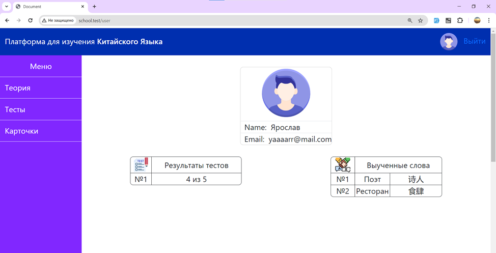
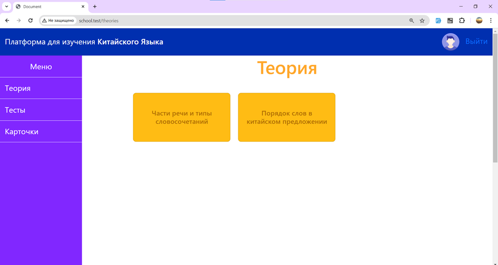
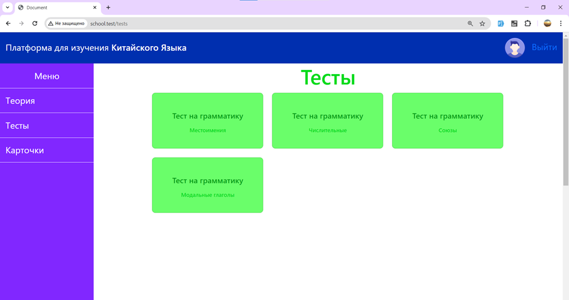
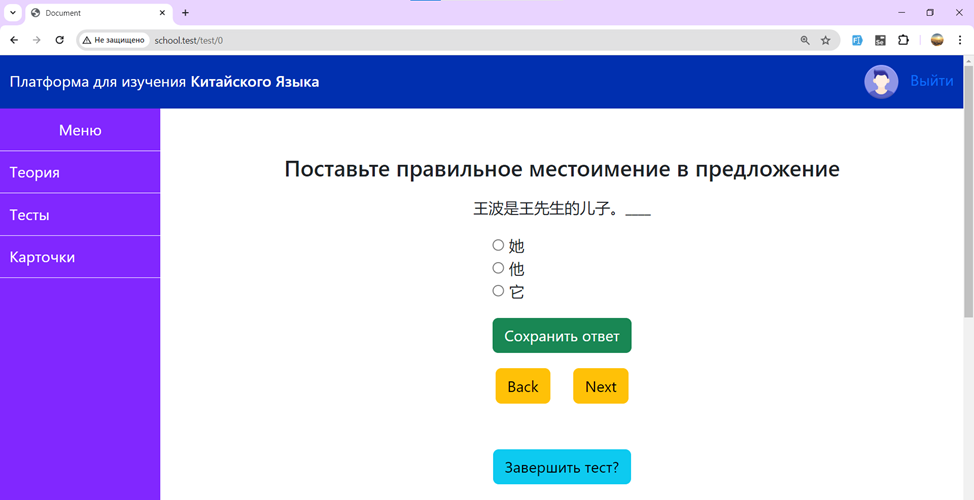
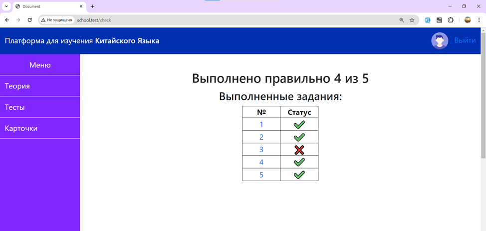
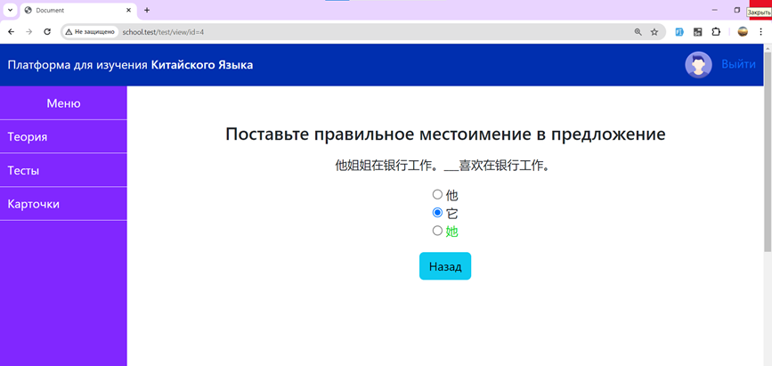
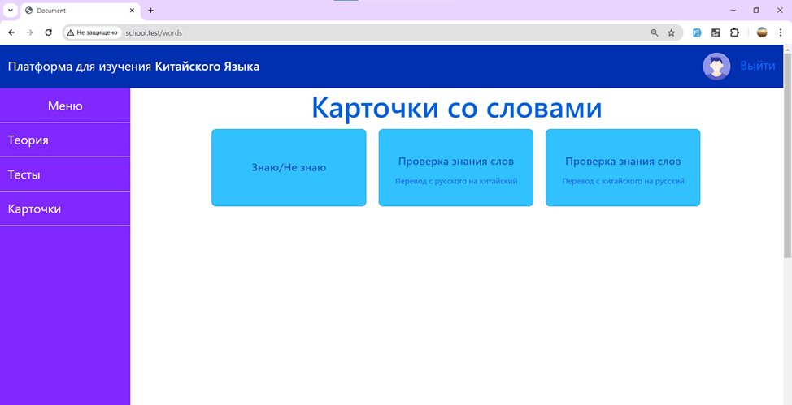
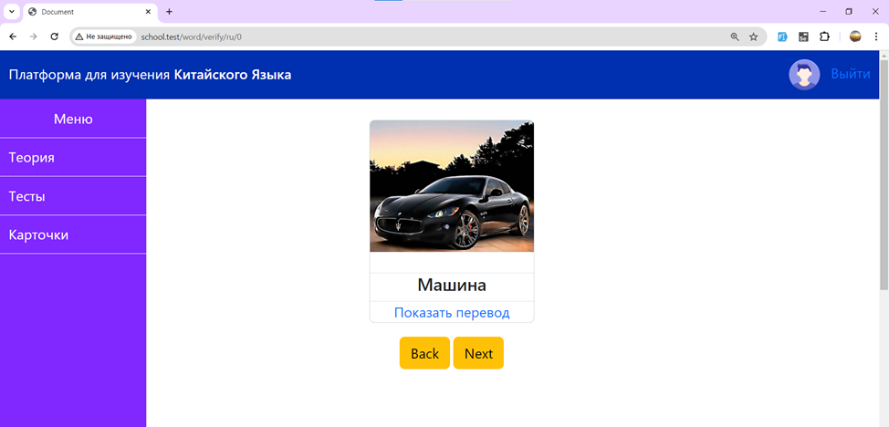
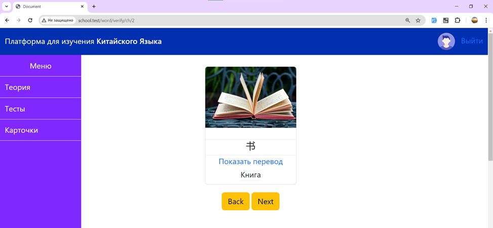
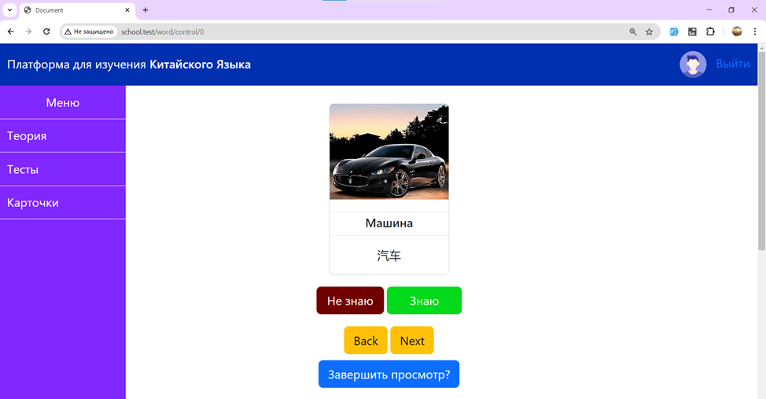

# Система для изучения китайского языка
Система помогает пользователю регулярно изучать китайский язык, отслеживая прогресс в личном кабинете. С помощью меню пользователь может перейти к разделу, в котором расположена теория на определённую тему китайского языка, а перейдя в другой раздел, пользователь может закрепить теорию с помощью тестов, ещё есть раздел, помогающий выучить новые слова, используя перевод с китайского на русский язык или перевод с русского на китайский язык.

## Содержание
- [Функции системы](#функции-системы)
    - [Личный кабинет](#личный-кабинет)
    - [Теория](#теория)
    - [Тесты](#тесты)
    - [Карточки для изучения слов](#карточки-для-изучения-слов)
    - [Повторение слов](#повторение-слов)
- [Технологический стек](#технологический-стек)
- [Архитектура системы](#архитектура-системы)
- [Требования для запуска](#требования-для-запуска)

## Функции системы
### Личный кабинет
В личном кабинете пользователя видны результаты пройденных тестов и выученные слова.

  

### Теория
Можно выбрать интересующую тему и прочитать про неё в интерактивном учебнике.

  

### Тесты
Проверить теорию помогают тесты на разнообразные темы.

  

Все тесты имеют варианты выбора ответа.

  

После завершения теста можно посмотреть результат.

  

Также можно открыть пройденное задание для сравнения ответа пользователя с правильным ответом системы.

  

### Карточки для изучения слов
Раздел "Карточки" предлагает 2 варианта изучения новых слов либо используя перевод с русского на китайский язык, либо с китайского на русский язык.

  

  

  

### Повторение слов
Пользователь может отмечать слова с помощью кнопок «Знаю» и «Не знаю», чтобы управлять списком выученной лексики:
- Знаю — исключает слово из выборки для изучения слов и добавляет его в список выученных слов, отображаемый в личном кабинете;
- Не знаю — удаляет слово из списка выученных слов и возвращает его в выборку для изучения.
При изучении слов система формирует выборку с учётом установленных пользователем статусов карточек.

  

## Технологический стек
В проекте используются следующие технологии:
- PHP — язык программирования, используемый для реализации серверной бизнес-логики;
- Laravel — фреймворк для разработки серверной части приложения;
- MySQL — реляционная система управления базами данных, предназначенная для хранения и обработки данных приложения;
- HTML — язык разметки для формирования структуры пользовательского интерфейса;
- CSS — язык стилей для оформления пользовательского интерфейса;
- Bootstrap - CSS-фреймворк для создания адаптивного интерфейса веб-приложений.

## Архитектура системы
Система разработана на основе клиент-серверной архитектуры. Взаимодействие компонентов приложения организовано по архитектурному шаблону MVC (Model–View–Controller).
Основные компоненты системы:
- Model (модель) — отвечает за взаимодействие с базой данных, получение и изменение данных пользователей, учебных материалов, слов и результатов тестирования;
- View (представление) — отвечает за отображение пользовательского интерфейса, включая личный кабинет, теоретические материалы, тесты и карточки для изучения слов;
- Controller (контроллер) — обрабатывает запросы пользователя, выполняет необходимую логику приложения и передаёт данные для отображения.

При работе с приложением пользователь взаимодействует с веб-интерфейсом. Запрос поступает на сервер, где Laravel определяет соответствующий маршрут и передаёт управление контроллеру. Контроллер обрабатывает запрос, при необходимости обращается к моделям для получения или изменения данных в MySQL, а затем возвращает результат пользователю в виде страницы.

## Требования для запуска
- PHP 8.1
- MySQL
- Современный веб-браузер
